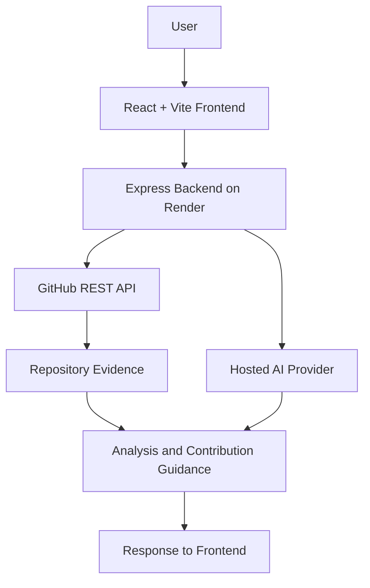

# 💜 OpenSource Mate AI

<div align="center">

### Your AI-Powered Companion for Open Source Contributions

**Understand repositories. Explore contribution opportunities. Turn confusing issues into a clearer starting point.**

[🚀 Live Demo](https://open-source-mate-ai-advanced.vercel.app/) · [💻 GitHub Repository](https://github.com/Madhuri-Kumari2504/OpenSource-Mate-AI-Advanced) · [🐛 Report a Bug](https://github.com/Madhuri-Kumari2504/OpenSource-Mate-AI-Advanced/issues)

<br/>


</div>

---

## ✨ About the Project

Contributing to open-source software can feel overwhelming when you're looking at an unfamiliar repository, trying to understand its structure, or deciding how to approach an issue.

**OpenSource Mate AI** is a web application designed to make that first step easier.

It combines GitHub repository inspection with AI-assisted guidance to help contributors understand project information, discover relevant files, and plan a practical approach to an issue.

Whether you're making your first contribution or exploring an unfamiliar codebase, the goal is simple: **spend less time feeling lost and more time learning, building, and contributing.**

## 🌟 Key Features

| Feature | What it helps you do |
|---|---|
| 🔍 **Repository Analyzer** | Inspect a GitHub repository and view available project information, technologies, scripts, and selected files. |
| 🧭 **Contribution Guide** | Get a structured starting guide for forking, cloning, setting up, testing, and contributing to a repository. |
| 🤖 **AI Contribution Planner** | Generate an issue-focused investigation and implementation plan using issue details and retrieved repository evidence when available. |
| ✍️ **PR Writing Assistance** | Intended to help contributors prepare clearer pull-request content. Verify the current implementation before relying on it. |

> **Note:** AI-generated recommendations are suggestions, not proof that a bug has been reproduced or fixed. Always verify code changes, commands, and tests against the actual repository.

## 🎯 Why OpenSource Mate AI?

- **Beginner-friendly:** Breaks the contribution process into manageable steps.
- **Repository-aware:** Uses GitHub evidence where retrieval succeeds.
- **Practical:** Emphasizes investigation, implementation, and testing rather than unsupported guesses.
- **AI-assisted:** Helps turn issue descriptions into structured next steps.
- **Built for learning:** Encourages contributors to understand the codebase instead of blindly copying solutions.

## 🖥️ Live Application

Try the deployed application:

### [🚀 Open OpenSource Mate AI](https://open-source-mate-ai-advanced.vercel.app/)

The frontend is deployed on Vercel, and the backend is hosted on Render.

**Want to explore the code?** Visit the [GitHub repository](https://github.com/Madhuri-Kumari2504/OpenSource-Mate-AI-Advanced).

> **Screenshots coming soon:** Add real application screenshots to a `docs/screenshots/` directory and embed them here. Real screenshots are more useful than mockups because they show contributors exactly what the application looks like.

<!--
After adding screenshots, replace this comment with:

<div align="center">
  
  <p><em>OpenSource Mate AI dashboard</em></p>
</div>
-->

## 🏗️ Architecture



### How it works

1. A user submits a GitHub repository or issue details through the frontend.
2. The backend validates the input and retrieves relevant repository information from GitHub when requested.
3. The AI planner sends its prompt to the configured hosted AI provider.
4. The backend returns the available analysis or generated guidance to the frontend.

Repository inspection and AI generation are separate operations. If repository evidence cannot be retrieved, the application should communicate that limitation rather than invent repository facts.

## 🛠️ Tech Stack

| Technology | Role |
|---|---|
| React | User interface |
| Vite | Frontend development and build tooling |
| Node.js | Backend JavaScript runtime |
| Express.js | REST API and request handling |
| GitHub REST API | Repository metadata and file retrieval |
| Hosted AI API | AI-assisted contribution planning |
| Vercel | Frontend deployment |
| Render | Backend deployment |

## 🚀 Run Locally

### Prerequisites

Install the following before getting started:

- [Node.js](https://nodejs.org/)
- [Git](https://git-scm.com/)
- A GitHub account
- A hosted AI API key if you want to use AI-powered features

### 1. Clone the repository

```bash
git clone https://github.com/Madhuri-Kumari2504/OpenSource-Mate-AI-Advanced.git
cd OpenSource-Mate-AI-
