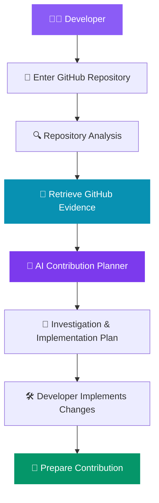
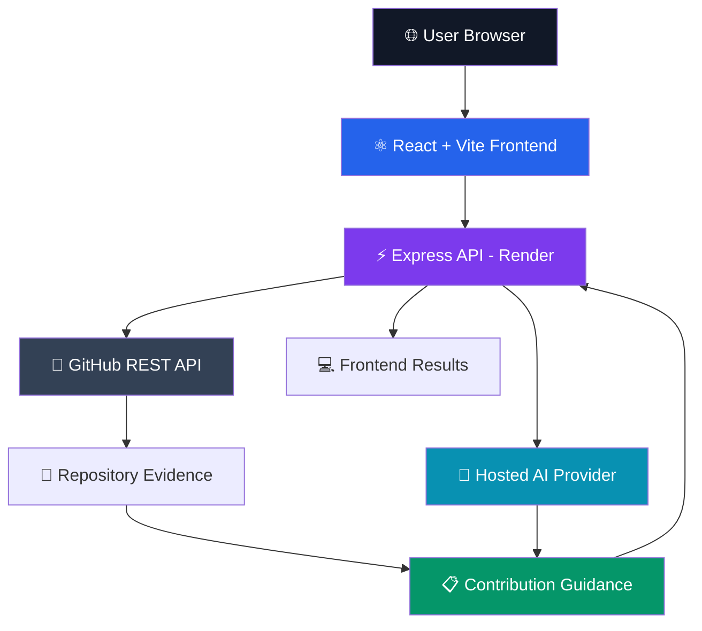

<div align="center">

# 💜 OpenSource Mate AI

### 🚀 Your Intelligent Companion for Open Source Contributions

**Explore Repositories. Understand Issues. Build with Confidence.**

<br/>

[](https://open-source-mate-ai-advanced.vercel.app/)
[](https://github.com/Madhuri-Kumari2504/OpenSource-Mate-AI-Advanced)

<br/>


<br/>

### ✨ Making Open Source More Accessible, One Contribution at a Time

An AI-assisted platform designed to help developers explore unfamiliar repositories, understand contribution opportunities, and approach GitHub issues with structured, actionable guidance.

<br/>

**👩‍💻 Independently Designed & Developed by Madhuri Kumari**

*Built with curiosity, creativity, and a passion for open source.*

</div>

---

## 🌍 THE VISION

> ### "Every great open-source contribution begins with understanding."

Open source is one of the most powerful ways to learn software engineering, collaborate with developers, and build meaningful technology.

But getting started can be difficult.

Developers often face:

- Unfamiliar repository structures
- Complex project setup instructions
- Unclear contribution guidelines
- Difficult-to-understand GitHub issues
- Uncertainty about where to begin

**OpenSource Mate AI** was created to make this journey simpler.

By combining GitHub repository information with AI-assisted reasoning, the platform helps transform confusion into a clearer contribution plan.

### 🎯 Mission

**Empower developers to move from discovering an open-source project to making their first meaningful contribution with greater clarity and confidence.**

---

## 💎 KEY FEATURES

| Feature | Description | Benefit |
|:---|:---|:---|
| 🔍 **Repository Analyzer** | Explore repository metadata, technologies, scripts, and selected files | Understand unfamiliar codebases |
| 🧭 **Contribution Guide** | Receive structured steps for forking, cloning, setup, and testing | Start contributing with confidence |
| 🤖 **AI Contribution Planner** | Generate investigation and implementation plans using issue details and available repository evidence | Turn complex issues into manageable tasks |
| 📝 **PR Writing Assistance** | Planned or implementation-dependent assistance for pull-request descriptions | Communicate changes more clearly |
| 🌐 **GitHub Integration** | Retrieve available repository information through GitHub APIs | Ground guidance in real project context |
| ⚡ **Interactive Experience** | Navigate analysis and guidance through a modern web interface | Simplify the learning process |

> **Important:** AI-generated guidance is advisory. It does not guarantee that an issue has been reproduced, a fix is correct, or tests have passed.

---

## 🧠 HOW IT WORKS



### ⚙️ Contribution Workflow

| Step | Action | Outcome |
|:---:|---|---|
| 01 | Submit repository URL | Identify the target project |
| 02 | Inspect repository | Understand available project information |
| 03 | Explore an issue | Identify the problem and expected behavior |
| 04 | Generate AI guidance | Receive suggested investigation steps |
| 05 | Plan implementation | Identify possible files and changes |
| 06 | Validate locally | Run relevant checks and tests |
| 07 | Prepare pull request | Communicate the contribution |

---

## 🏗️ SYSTEM ARCHITECTURE



### 🔬 Behind the Scenes

**1. Frontend**

The React application provides the interface for entering repositories, exploring project information, and reviewing contribution guidance.

**2. Backend**

The Express server handles API requests, input validation, repository inspection, and AI service communication.

**3. GitHub Integration**

The GitHub REST API supplies repository information when retrieval succeeds.

**4. AI Assistance**

A configured hosted AI provider generates issue-focused recommendations using the available context.

**5. Results**

The frontend presents structured guidance that developers can verify and use as a starting point.

---

## 🛠️ TECHNOLOGY STACK

<div align="center">

### 🎨 Frontend


### ⚙️ Backend


### ☁️ APIs & Deployment


</div>

| Technology | Responsibility |
|---|---|
| React | Interactive user interface |
| Vite | Frontend development and production builds |
| Node.js | Backend runtime |
| Express.js | API routing and request handling |
| GitHub REST API | Repository metadata and content retrieval |
| Hosted AI API | AI-assisted contribution planning |
| Vercel | Frontend hosting |
| Render | Backend hosting |

---

## 🌐 LIVE APPLICATION

<div align="center">

### 🚀 Experience OpenSource Mate AI

**From Repository Discovery to Contribution Planning**

<br/>

[](https://open-source-mate-ai-advanced.vercel.app/)

<br/>

**Live Website**

https://open-source-mate-ai-advanced.vercel.app/

<br/>

**Source Code**

https://github.com/Madhuri-Kumari2504/OpenSource-Mate-AI-Advanced

</div>

---

## 📂 PROJECT STRUCTURE

The exact directory structure may vary with the repository version. A typical separation of concerns is:

```text
OpenSource-Mate-AI-Advanced/
│
├── frontend/              # React application
│   ├── src/
│   ├── public/
│   └── package.json
│
├── backend/               # Express API
│   ├── routes/
│   ├── services/
│   └── package.json
│
└── README.md
```

Refer to the repository for the authoritative directory structure.

---

## 🚀 GETTING STARTED

### Prerequisites

Before running the project, install:

- Node.js
- npm
- Git
- A modern web browser
- A hosted AI API key for AI-powered functionality

### 1️⃣ Clone the Repository

```bash
git clone https://github.com/Madhuri-Kumari2504/OpenSource-Mate-AI-Advanced.git
```

### 2️⃣ Navigate to the Project

```bash
cd OpenSource-Mate-AI-Advanced
```

### 3️⃣ Install Dependencies

Check the repository's package files and install dependencies in the relevant application directories.

For an npm-based package:

```bash
npm install
```

### 4️⃣ Configure Environment Variables

Configure the backend with the credentials and service URLs required by its implementation.

Example placeholders:

```env
AI_API_KEY=your_api_key
GITHUB_TOKEN=your_github_token
PORT=5000
```

These are illustrative names. Use the exact environment variable names expected by the code.

Never commit real secrets to GitHub.

### 5️⃣ Start the Application

Check the available scripts:

```bash
npm run
```

Then run the appropriate frontend and backend development commands from their respective package directories.

---

## 🔐 SECURITY & RESPONSIBLE AI

OpenSource Mate AI is designed to support informed contribution planning.

### Our Principles

- **Evidence over assumptions:** Prefer retrieved repository information.
- **Transparency:** Communicate when repository information is unavailable.
- **Human verification:** Treat AI suggestions as starting points.
- **Secure credentials:** Keep API keys on the backend.
- **Responsible contributions:** Respect repository licenses and contribution guidelines.

> AI-generated recommendations should be independently verified. The application does not automatically guarantee correct code changes or successful pull requests.

---

## 🗺️ FUTURE ROADMAP

| Phase | Planned Enhancement |
|---|---|
| Phase 1 | Improved repository structure visualization |
| Phase 2 | Beginner-friendly issue recommendations |
| Phase 3 | More detailed issue investigation guidance |
| Phase 4 | Enhanced pull-request drafting |
| Phase 5 | Contribution progress tracking |
| Phase 6 | Repository-specific setup assistance |
| Phase 7 | Automated testing and deployment improvements |

*These are proposed improvements and not necessarily implemented features.*

---

## 🤝 CONTRIBUTING

Contributions, ideas, and constructive feedback are welcome.

### Contribution Steps

1. Fork the repository.
2. Create a new feature branch.
3. Implement your changes.
4. Test your implementation.
5. Commit with a descriptive message.
6. Open a pull request.

### 🐛 Found an Issue?

[](https://github.com/Madhuri-Kumari2504/OpenSource-Mate-AI-Advanced/issues)

---

## 📄 LICENSE

Refer to the repository's existing license information before copying, modifying, or redistributing the software.

If no license is present, a license should be selected and added explicitly.

---

## 👩‍💻 MEET THE CREATOR

<div align="center">

### 💜 Independently Built by Madhuri Kumari

**Developer • Creator • Open Source Enthusiast**

<br/>

[](https://github.com/Madhuri-Kumari2504)

<br/>

> "Building tools that make technology easier to explore, understand, and contribute to."

OpenSource Mate AI is an independently developed project by **Madhuri Kumari**, created with the goal of making open-source participation more approachable and productive.

The project reflects an interest in full-stack development, API integrations, artificial intelligence, and developer-focused tools.

### 🔗 Connect

| Platform | Link |
|---|---|
| 🐙 GitHub | [@Madhuri-Kumari2504](https://github.com/Madhuri-Kumari2504) |
| 💻 Project | [OpenSource Mate AI](https://github.com/Madhuri-Kumari2504/OpenSource-Mate-AI-Advanced) |
| 🌐 Live Demo | [Launch Application](https://open-source-mate-ai-advanced.vercel.app/) |
| 🐛 Issues | [Report an Issue](https://github.com/Madhuri-Kumari2504/OpenSource-Mate-AI-Advanced/issues) |

</div>

---

<div align="center">

# 💜 OpenSource Mate AI

### Explore. Understand. Contribute.

**Making open source more accessible through AI-powered guidance.**

<br/>

[](https://open-source-mate-ai-advanced.vercel.app/)

[](https://github.com/Madhuri-Kumari2504/OpenSource-Mate-AI-Advanced)

<br/>

### Made with 💜 by Madhuri Kumari

**One Developer. One Vision. Endless Possibilities.**

</div>
